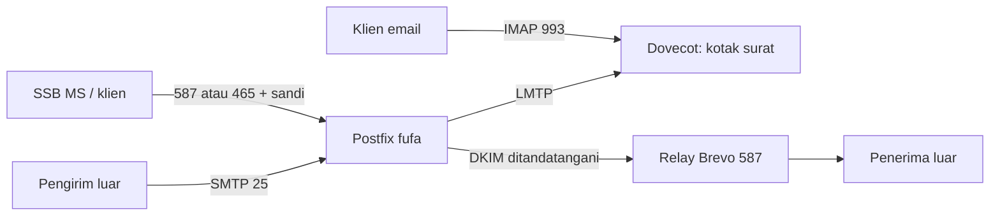

# Email untuk domain akademi

Email `familyunitedfa.com` berjalan di server yang sama dengan SSB MS (`fufa`, `124.156.192.17`, hostname `mail.familyunitedfa.com`), tidak lagi bergantung pada server zukelabs. Menerima email dari luar langsung di server ini; mengirim ke luar lewat relay SMTP Brevo.

## Kenapa memakai relay untuk kirim keluar

Penyedia VPS memblokir koneksi keluar ke port 25 (diuji dari `fufa`: port 25 Gmail tertutup, 465 dan 587 terbuka) dan alamat IP-nya tidak punya reverse DNS yang cocok. Kirim langsung dari server akan ditolak atau masuk spam. Karena itu Postfix meneruskan semua email keluar ke `smtp-relay.brevo.com:587`, sedangkan email masuk tetap diterima langsung di port 25.



## Yang terpasang di fufa

| Komponen | Peran | Port |
|---|---|---|
| Postfix | Terima dan kirim SMTP; domain virtual `familyunitedfa.com` | 25 (masuk), 587 STARTTLS dan 465 TLS (kirim, wajib login) |
| Dovecot | IMAP, pengiriman lokal (LMTP), autentikasi | 993 |
| OpenDKIM | Tanda tangan email keluar, selektor `fufa`, RSA 2048 | 127.0.0.1:8891 |
| Certbot | Sertifikat `mail.familyunitedfa.com` (validasi lewat vhost Nginx `mail.familyunitedfa.com`), diperbarui otomatis dan memuat ulang layanan | |

Kotak surat: `noreply@` (untuk aplikasi), `admin@`, `info@`. Alias `postmaster@`, `hostmaster@`, `abuse@`, `webmaster@` mengarah ke `admin@`. Kata sandi acak ada di `/root/mail-passwords.txt` di server (hanya root). Data: `/var/mail/vmail/familyunitedfa.com/<nama>/Maildir`.

Berkas konfigurasi: `/etc/postfix/main.cf`, `/etc/postfix/vmailbox` (daftar kotak surat), `/etc/postfix/valias`, `/etc/dovecot/dovecot.conf`, `/etc/dovecot/users`, `/etc/opendkim.conf`.

## Memasang kunci Brevo (sekali)

Kunci SMTP Brevo tidak disimpan di repo atau percakapan. Di server:

```
sudo brevo-key
```

Perintah itu menanyakan kunci (tidak tampil saat diketik), menyimpannya di `/etc/postfix/sasl_passwd` (0600), mengaktifkan relay, dan mengirim antrean yang tertahan. Login relay: `bf9c1e001@smtp-brevo.com`. Kunci dibuat di Brevo: SMTP & API, tab SMTP, Generate a new SMTP key.

Di Brevo, domain pengirim juga harus disahkan (Senders, Domains & Dedicated IPs, Add a domain `familyunitedfa.com`). Brevo memberi beberapa record DNS (kode `brevo-code` dan DKIM milik Brevo); pasang juga di Domainesia, kalau tidak, Brevo menolak pengirim `@familyunitedfa.com`.

## Record DNS di Domainesia

| Tipe | Nama | Isi |
|---|---|---|
| A | `mail` | `124.156.192.17` (sudah ada) |
| MX | `@` | `10 mail.familyunitedfa.com` (ganti yang lama `0 familyunitedfa.com`) |
| TXT | `@` | `v=spf1 mx ip4:124.156.192.17 include:spf.brevo.com -all` |
| TXT | `fufa._domainkey` | kunci DKIM di bawah |
| TXT | `_dmarc` | `v=DMARC1; p=none; rua=mailto:admin@familyunitedfa.com` |
| (dari Brevo) | | record pengesahan domain Brevo |

Kunci DKIM (satu baris; kalau panel memecahnya otomatis, itu normal):

```
v=DKIM1;h=sha256;k=rsa;p=MIIBIjANBgkqhkiG9w0BAQEFAAOCAQ8AMIIBCgKCAQEAwv3cPV/fi2Gf+w/PrYPPu16EvprMmd9Dh4kbz1ZExf2K7ceG2CLutX20YVpaSVJm7eRbM/KxOMqHtFMznseyecqJmBzYqUPXKMkQExtexuj9Jgv7F2YS/nx93+YAQpJV1IvvGK+EgNkE9UlUTRfY+2vxv57fixCRhdtK2LK54cV+BsZ3WPPAOjVuiEYAyF/4bGNRPLrDCsuTnGuj38lLPN1eBlRKKAGTunD9TUYyAg2iQzlB1ImqJ3y/vu2quRTJI0gUQsZjUAPCN32mvtZLIXLeYnPcUylRUBrLJfAZUpkJyQGJJZeG85SXFeRCy65YOyFcTbP0X8ahRvhHiGBHnwIDAQAB
```

Firewall: `ufw` di server sudah membuka 25, 465, 587, 993. Firewall di konsol penyedia VPS juga harus membuka port TCP yang sama; itu hanya bisa diatur dari konsolnya.

Reverse DNS (PTR) `124.156.192.17` → `mail.familyunitedfa.com` diatur dari konsol penyedia. Tidak wajib untuk email keluar karena memakai relay, tetapi membantu bila ada pengirim yang memeriksa server masuk.

## Klien email

IMAP `mail.familyunitedfa.com` port 993 (SSL/TLS), SMTP `mail.familyunitedfa.com` port 587 (STARTTLS) atau 465 (SSL/TLS). Nama pengguna adalah alamat lengkap.

## Menghubungkan SSB App

Aplikasi memakai satu `SMTP_URL` dan satu `MAIL_FROM` (lihat `apps/api/src/mail.ts`):

```
SMTP_URL=smtps://noreply%40familyunitedfa.com:<sandi>@mail.familyunitedfa.com:465
MAIL_FROM="Family United FA <noreply@familyunitedfa.com>"
```

`@` di nama pengguna ditulis `%40`; karakter lain yang perlu di-encode: `:` `%3A`, `/` `%2F`, `#` `%23`.

## Pemeriksaan

Sudah diuji di server pada 23 Oktober 2026: login SMTP 587 dan 465, pengiriman antar kotak surat lokal, pembacaan lewat IMAP 993, dan tanda tangan DKIM (`d=familyunitedfa.com; s=fufa`) pada email keluar.

Setelah DNS dan kunci Brevo terpasang:

```
dig +short MX familyunitedfa.com
dig +short TXT familyunitedfa.com
dig +short TXT fufa._domainkey.familyunitedfa.com
sudo mailq                      # antrean kosong bila semua terkirim
sudo journalctl -u postfix --since '5 min ago' | grep -E 'status=(sent|deferred|bounced)'
```

## Menambah kotak surat

Tambah baris di `/etc/postfix/vmailbox` (`alamat domain/nama/Maildir/`), jalankan `sudo postmap /etc/postfix/vmailbox`, tambah baris di `/etc/dovecot/users` dengan hash dari `doveadm pw -s SHA512-CRYPT`, buat folder `/var/mail/vmail/familyunitedfa.com/<nama>` milik `vmail`, lalu `sudo systemctl reload postfix dovecot`.

## Batasan

- Satu `SMTP_URL` untuk seluruh deployment. Email dari domain tiap SSB yang berbeda butuh pengaturan SMTP per SSB, belum dibuat.
- Paket gratis Brevo dibatasi jumlah email per hari; cukup untuk reset sandi dan undangan SSB kecil.
- Tidak ada webmail dan penyaring spam untuk email masuk; cukup untuk beberapa kotak surat, belum untuk lalu lintas besar.
- Mail server zukelabs (`mail.zukelabs.web.id`) masih mengenal domain ini sampai MX diganti, dan tidak lagi diperlukan setelah itu.
