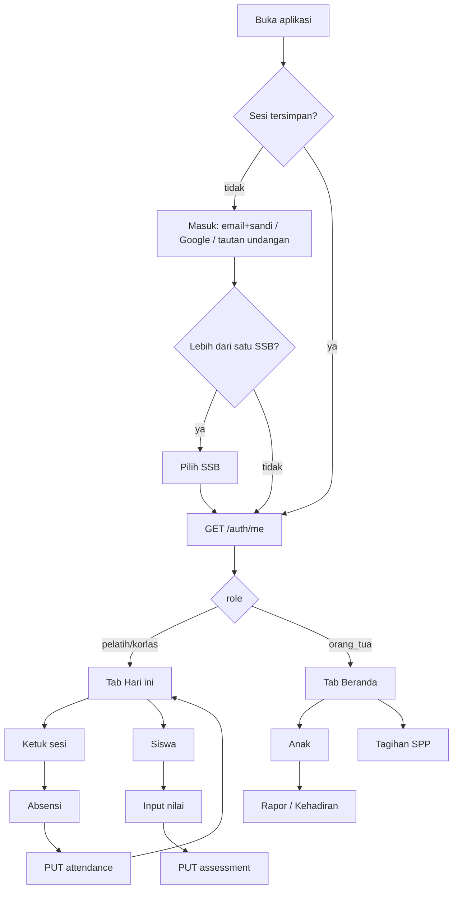

# Rancangan aplikasi mobile: pelatih dan orang tua

Status: M0 sampai M6 sudah dikerjakan di kode `apps/mobile` dengan Flutter (lihat bagian 7 untuk bagian yang belum diuji di perangkat). Melengkapi `docs/mobile.md` (push dan offline); bagian pilihan teknologi di sana digantikan keputusan Flutter di bagian 4.

## 1. Cakupan

Hanya dua peran: `pelatih` (termasuk `korlas`) dan `orang_tua`. Admin SSB tetap di web. Alur dan data sama dengan web; tidak ada logika bisnis baru di aplikasi.

Prinsip layar:
- Satu aplikasi, dua mode. Setelah login, `GET /auth/me` memberi `active.role`; role itu memilih set tab (pelatih/korlas vs orang tua). Pengguna yang punya dua SSB memakai layar Pilih SSB yang sudah ada (`/auth/select`).
- Izin tetap ditegakkan server (`docs/izin.md`). Aplikasi hanya menyembunyikan menu; jangan menyimpulkan izin dari role di klien selain untuk memilih tab.
- Pelatih: satu tangan, tombol besar, tanpa langkah ekstra di lapangan.
- Orang tua: baca-saja untuk sebagian besar layar, isinya cepat terbuka.

## 2. Peta layar

### Pelatih / korlas (tab bawah: Hari ini, Siswa, Jadwal, Akun)

| Tab | Layar | Isi | Padanan web | API |
|---|---|---|---|---|
| Hari ini | Beranda | Sesi hari ini dan berikutnya, kehadiran KU, siswa yang perlu perhatian (cedera, nilai turun) | `DashboardStaf` | `GET /sessions?from&to`, `/attendance/summary`, `/players-overview`, `/squad` |
| Hari ini | Absensi sesi | Daftar siswa, satu ketuk ganti status hadir/izin/sakit/alpa, "tandai semua hadir", simpan | `/absensi/[id]` | `GET/PUT /sessions/:id/attendance` |
| Siswa | Daftar siswa | Cari, saring KU, foto, rating | `/pemain` | `GET /players`, `/players-overview` |
| Siswa | Profil siswa | Rating, radar enam aspek, posisi, lencana, cedera, tren | `/pemain/[id]` | `GET /players/:id`, `/badges`, `/injuries`, `/market-value` |
| Siswa | Input nilai | Pilih periode, skor per indikator (stepper besar), simpan, terbitkan (korlas) | `/nilai/[id]` | `GET /assessment-indicators`, `PUT /players/:id/assessments/:periodId`, `POST/DELETE .../publish` |
| Siswa | Rencana pengembangan | Daftar butir per periode | `/rencana/[id]` | `GET/PUT /players/:id/development-plan/:periodId` |
| Siswa | Catat cedera, beri lencana | Formulir singkat | di profil web | `POST/PATCH /players/:id/injuries`, `POST/DELETE .../badges` |
| Jadwal | Jadwal | Daftar sesi per minggu, lokasi, jam; ketuk membuka absensi | `/jadwal` (baca) | `GET /sessions` |
| Jadwal | Kalender | Pertandingan dan acara akademi | `/kalender` | `GET /calendar` |
| Akun | Akun | Profil, ganti sandi, ganti SSB, keluar | `/akun` | `PATCH /me`, `/auth/change-password`, `/auth/select`, `/auth/logout` |

Tidak masuk mobile pelatih (tetap web): kelola jadwal (`session.manage` hanya admin), indikator, bobot posisi, master, penugasan, artikel, donasi/merchandise.

### Orang tua (tab bawah: Beranda, Anak, Tagihan, Akun)

| Tab | Layar | Isi | Padanan web | API |
|---|---|---|---|---|
| Beranda | Beranda | Sesi berikutnya anak, kartu tagihan belum lunas, 5 kehadiran terakhir | `PortalOrangTua` | `GET /guardian/sessions`, `/attendance/summary`, `/invoices` |
| Anak | Pilih anak (bila >1) lalu profil | Rating, radar, lencana, cedera, indeks nilai kategori | `/pemain/[id]` | `GET /players`, `/players/:id`, `/badges`, `/injuries` |
| Anak | Rapor | Hasil per periode (hanya yang terbit), rencana pengembangan, unduh PDF | `HasilNilai`, `/rencana/[id]` | `GET /players/:id/assessments`, `/development-plan/:periodId`, `/assessments/:periodId/report` |
| Anak | Kehadiran | Persentase dan riwayat sesi | `/kehadiran` | `GET /attendance/summary`, `/guardian/sessions` |
| Anak | Berkas | Unggah/lihat KK, akta, NISN | `BerkasSiswa` | `GET/POST /players/:id/documents` |
| Anak | Kartu QR | Kartu pemain dengan QR | `/kartu/[id]` | `GET /players/:id` |
| Tagihan | SPP | Daftar tagihan, sisa, jatuh tempo, info rekening, riwayat bayar | `SppOrtu` | `GET /invoices`, `/fees/public-info` |
| Beranda | Kalender dan donasi | Jadwal akademi, kampanye aktif, sumbang | `/kalender`, `/donasi` | `GET /calendar`, `/fundraising`, `POST /fundraising/:id/pledges` |
| Akun | Akun | Sama dengan pelatih | `/akun` | sama |

Izin tidak ada di API, jadi `docs/mobile.md` menyebut "ajukan izin" dan "absen QR orang tua" sebagai kebutuhan baru; keduanya butuh endpoint baru (lihat bagian 6).

## 3. Alur utama



Pelatih, jalur absensi (alur terpenting, target dua ketuk dari layar utama):
1. Beranda menampilkan kartu "Latihan sekarang: KU-10, 16.00" bila sesi hari ini ada.
2. Ketuk kartu membuka daftar siswa; semua `belum dicatat`.
3. Ketuk baris untuk menggilir status; tombol "Semua hadir" untuk massal.
4. Simpan sekali (`PUT` seluruh daftar, seperti web). Indikator "tersimpan / menunggu sinyal".

Orang tua, jalur harian: buka, lihat sesi berikutnya dan tagihan di Beranda, selesai. Rapor dan kehadiran satu ketuk dari tab Anak.

## 4. Keputusan teknis

### 4.1 Teknologi: Flutter (diputuskan)
Satu basis kode Dart untuk Android, iOS, dan juga web/Windows bila perlu, di `apps/mobile`. Aplikasi memakai API yang sama dengan web; tidak ada logika bisnis di klien selain pemilihan tab menurut role. Keputusan ini menggantikan urutan PWA, lalu Capacitor di `docs/mobile.md`; PWA web yang sudah ada tetap dipakai admin.

Paket: `http` (klien), `flutter_secure_storage` (token di Keychain/Keystore), `go_router` (navigasi dan guard login), `provider` (state), `intl` (tanggal dan rupiah berbahasa Indonesia), `shared_preferences` (antrean offline dan preferensi), `firebase_core`/`firebase_messaging` (push), `url_launcher`/`app_links` (login Google dan tautan web), `package_info_plus` (versi di Akun).

### 4.2 Autentikasi: token bearer
Cookie `ssb_session` (SameSite=Lax) tidak cocok untuk klien non-browser. API sekarang punya jalur kedua yang memakai tabel `user_session` yang sama:
- `POST /auth/token` (body sama dengan `/auth/login`) mengembalikan `{token, expiresAt, selected, memberships}` tanpa mengatur cookie.
- Middleware `loadAuth` membaca `Authorization: Bearer <token>` lebih dulu, lalu cookie. Semua endpoint, termasuk `/auth/select` dan `/auth/logout`, bekerja dengan token itu.
- Token berlaku 7 hari seperti cookie, disimpan sebagai hash di server. Ganti kata sandi mencabut sesi lain (termasuk token).
- Bearer tidak dikirim otomatis oleh peramban, jadi tidak membuka jalur CSRF baru; `csrf()` hanya memeriksa permintaan berbentuk form.
- Aplikasi yang mendapat 401 untuk permintaan bertoken menghapus token dan kembali ke layar masuk.

### 4.3 Struktur proyek
```
apps/mobile/lib/
  core/       api.dart (klien + ApiException), session.dart (status login), repository.dart (akses data),
              models.dart, format.dart, widgets.dart (LoadView, avatar, chip status)
  features/   auth, coach (hari ini, absensi, jadwal), parent (beranda, tagihan), players, account, shell
  app.dart    router dan guard; main.dart: dependensi
```
Alamat API dan web diatur saat build: `flutter run --dart-define=API_URL=https://ssb-ms.zukelabs.web.id/api --dart-define=WEB_URL=https://ssb-ms.zukelabs.web.id`. Bawaan API: `http://10.0.2.2:3000` (emulator Android) atau `http://localhost:3000`; bawaan web: `https://ssb-ms.zukelabs.web.id`. Panduan menjalankan, Firebase, dan penandatanganan: `apps/mobile/README.md`.

### 4.4 Offline (M4)
1. Simpan draf absensi dan nilai di penyimpanan lokal dan kirim ulang bila sinyal kembali. Aman karena `PUT` bersifat menimpa dan idempoten. Beri penanda "menunggu sinyal" yang terlihat.
2. Konflik: dua pelatih menyunting sesi yang sama; terbaru menang, jejak lama di riwayat (nilai sudah punya `history`).

## 5. Notifikasi
Jenis (satu kali per peristiwa, ketukan menuju layar terkait):

| Penerima | Peristiwa | Tujuan ketuk |
|---|---|---|
| Orang tua | Jadwal berubah/batal | Beranda |
| Orang tua | Rapor terbit | Rapor anak |
| Orang tua | Tagihan baru / jatuh tempo | Tagihan |
| Pelatih | Sesi akan mulai (30 menit) | Absensi sesi |
| Pelatih | Penugasan KU berubah | Hari ini |

Pengiriman WhatsApp lewat Fonnte (`docs/fonnte.md`) sudah menutup tagihan; push melengkapi, bukan menggantikan, sampai pemakaian aplikasi cukup tinggi.

## 6. Pekerjaan backend yang dibutuhkan

| Item | Perlu untuk | Catatan |
|---|---|---|
| Tabel `push_subscription` dan endpoint daftar/cabut | Push | Per akun, per perangkat; pengirim terpisah dari alur utama |
| Token bearer | Klien non-browser | Selesai: `POST /auth/token`, header `Authorization: Bearer` dibaca bersama cookie, logout mencabut sesi |
| Pengajuan izin orang tua | Fitur izin | Endpoint baru: `POST /guardian/absence-requests`, izin baru `absence.request` untuk `orang_tua`, tampil di daftar tugas pelatih/admin; belum ada di API |
| Absen QR | Scan kartu | Endpoint baru; web sudah punya kartu QR, belum ada pemindai |
| Tidak ada: API khusus mobile | semua layar lain | Semua endpoint di tabel bagian 2 sudah ada |

## 7. Tahapan

| Tahap | Isi | Status |
|---|---|---|
| M0 | Proyek Flutter `apps/mobile`, token bearer di API (`POST /auth/token`), login, pilih SSB, tab per role | Selesai |
| M1 | Pelatih: Hari ini, absensi, daftar siswa, jadwal. Orang tua: beranda, anak, tagihan SPP. Akun | Selesai |
| M2 | Input nilai dan rencana pengembangan (pelatih); rapor dan unduh PDF (orang tua); profil siswa lengkap (rating, radar, lencana, cedera) | Kode selesai; belum diuji di perangkat |
| M3 | Push (FCM untuk Android dan iOS lewat APNs), preferensi notifikasi di Akun, deep link dari notifikasi | Kode selesai (klien `features/platform/push_service.dart`, endpoint `/push/devices`); belum diuji di perangkat, butuh `google-services.json`, `GoogleService-Info.plist`, kunci APNs |
| M4 | Draf offline absensi dan nilai di penyimpanan lokal (`Outbox`, `shared_preferences`), antrean kirim ulang, "Kirim sekarang" dan galat penolakan server di Akun | Kode selesai; belum diuji di perangkat |
| M5 | Berkas siswa, donasi, kalender, kartu QR dan pemindai, pengajuan izin | Kode selesai; belum diuji di perangkat |
| M6 | Ikon dan splash (dibuat dengan `flutter_launcher_icons`/`flutter_native_splash`), penandatanganan Android lewat `key.properties`, login Google dan tautan `ssbapp://`, Play Store, TestFlight/App Store | Ikon, splash, konfigurasi tanda tangan, dan skema tautan selesai di kode; kapabilitas Push iOS, penandatanganan dengan keystore asli, build iOS, Play Store, dan TestFlight belum diuji |

Catatan: login Google dan tautan undangan/lupa kata sandi sekarang ada di aplikasi (Google lewat browser dan tautan balik `ssbapp://auth`; undangan dan lupa kata sandi dibuka di web). Antrean offline memakai `shared_preferences`, bukan SQLite, karena yang disimpan hanya isi `PUT` terakhir per entitas.

## 8. Yang perlu diputuskan
- [x] Siapa boleh absen/izin: orang tua mengajukan izin sendiri di aplikasi (`POST /guardian/absence-requests`, izin `absence.request`).
- [ ] Apakah korlas memakai tab pelatih yang sama (sekarang ya; tombol terbitkan rapor belum ada).
- [ ] Apakah pelatih boleh mengubah jadwal dari HP (sekarang `session.manage` hanya admin).
- [x] Login Google di aplikasi: deep link balik `ssbapp://auth?code=...` ditukar lewat `POST /auth/mobile-exchange`.
- [ ] Rate limit untuk `/auth/login` dan `/auth/token`: belum ada di API (berlaku juga untuk web).
