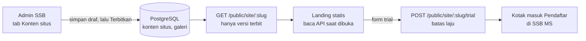

# Landing page akademi (company profile)

Situs publik untuk sebuah SSB: identitas akademi, program, tim, fasilitas, galeri, dan pendaftaran trial. Situs ini **berdiri sendiri**, terpisah dari SSB MS, tetapi seluruh isinya diatur dari SSB MS.

Status: rancangan. Desain dari tim ada di https://github.com/sanzuke/ssb-family-united (React + Vite + Tailwind, data masih tertulis di kode).

## Keputusan

- Landing dan SSB MS dipisah. Landing adalah situs statis di domain akademi (mis. `familyunitedfa.com`); SSB MS tetap di domainnya sendiri.
- Konten disunting admin SSB di SSB MS (tab **Konten situs**), lalu **Terbitkan**. Landing hanya membaca versi yang terbit lewat API publik.
- Tiap akademi punya satu landing di satu domain. Banyak akademi berarti banyak landing, dengan pola yang sama.

Alasan: tampilan landing (gelap, merah, amber) berbeda dari aplikasi (Garuda Muda) dan bisa berubah tanpa menyentuh aplikasi; deploy mandiri sehingga landing tidak bisa menjatuhkan login, absensi, atau SPP; halaman statis lebih cepat dan terbaca mesin pencari. Harganya: dua hal yang di-deploy dan satu kontrak API yang harus stabil, jadi bentuk respons didefinisikan dengan Zod di `packages/shared` dan dipakai kedua sisi.



## Batas data

Landing tidak pernah memuat nama pemain, foto pemain, absensi, nilai, rapor, atau tagihan. Nama pelatih hanya tampil bila anggota yang bersangkutan menyetujui. Yang tampil hanya yang admin tandai terbit; konten yang belum terbit menjawab 404.

## Konten dan data

Satu dokumen JSON per SSB (kolom `jsonb`), dengan dua salinan: draf dan terbit. Bagian landing berubah-ubah, dan dokumen menghindari migrasi tiap ada bagian baru. Bentuknya divalidasi Zod.

| Bagian | Isi | Sumber |
|---|---|---|
| Identitas dan kontak | Nama, motto, logo, alamat, telepon, email, WhatsApp | Konten situs |
| Hero | Judul, teks, tombol, foto | Konten situs |
| Angka ringkasan | Pemain aktif, alumni, persen beasiswa | Konten situs (pemain aktif bisa dihitung dari data) |
| Yayasan dan beasiswa | Cerita, syarat | Konten situs |
| Program | Nama, rentang usia, jadwal, kurikulum, biaya tampil | KU dan jadwal latihan, teks ditimpa admin |
| Pelatih | Nama, lisensi, pengalaman, foto | Anggota yang setuju tampil |
| Fasilitas | Lapangan, alamat, foto | Lokasi latihan, teks ditimpa admin |
| Pertandingan | Jadwal dan hasil | Daftar manual (event masuk fase 2) |
| Testimoni | Kutipan, nama | Konten situs |
| Galeri | Foto | Unggahan, satu jalur baca publik khusus galeri |

Semua teks punya kolom ID dan EN. Tabel baru:

- `site_content` (sudah ada, migrasi 0020): `ssb_id` (PK, FK ke `ssb`), `draft` (jsonb), `published` (jsonb, kosong = belum terbit), `published_at`, `published_by`, `updated_at`. RLS per SSB.
- `trial_registration` (sudah ada, migrasi 0020): `id`, `ssb_id`, `code` (TRL-XXXXXX, unik per SSB), data anak dan orang tua, program pilihan, ajukan beasiswa, catatan, `status` (baru, dihubungi, diterima, ditolak), `admin_note`, `created_at`. RLS per SSB.
- `site_gallery` (belum): `id`, `ssb_id`, `path`, `caption`, `sort`, `published`. Foto memakai penyimpanan yang sama dengan foto pemain, tetapi jalur baca publiknya hanya untuk galeri. Ditunda: landing sekarang memakai foto yang ikut ter-build.
- `site_domain` (belum): memetakan domain ke SSB. Ditunda: satu landing satu domain, dan landing memakai kode SSB di alamat API.

## Endpoint

Bagian publik tanpa sesi. Kode SSB (`slug`) di alamat menentukan SSB-nya; tidak ada input lain yang bisa menunjuk SSB.

| Endpoint | Izin | Fungsi |
|---|---|---|
| `GET /public/site/:slug` | publik | Konten terbit (`{ slug, ssbName, publishedAt, content }`), cache 60 detik; 404 bila belum terbit |
| `POST /public/site/:slug/trial` | publik, batas laju | Pendaftaran trial; 201 `{ code }`; hanya diterima bila situs terbit; 5 per jam per IP dan 100 per jam per SSB (429); kolom jebakan `website` terisi dijawab 201 tanpa menyimpan |
| `GET /site` | `site.manage` | Draf, `dirty` (ada perubahan belum terbit), `published`, `publishedAt` |
| `PUT /site` | `site.manage` | Simpan draf (divalidasi `siteContentSchema`) |
| `POST /site/publish` | `site.manage` | Salin draf menjadi versi terbit; 409 bila belum ada draf |
| `POST /site/unpublish` | `site.manage` | Tarik dari publik; draf tetap |
| `GET /trials?status=` | `trial.manage` | Kotak masuk pendaftar, terbaru dulu |
| `PATCH /trials/:id` | `trial.manage` | Ubah status dan catatan admin |
| `POST/DELETE /site/gallery` | `site.manage` | Unggah dan hapus foto galeri (belum) |

Izin baru: `site.manage` dan `trial.manage` (admin SSB).

CORS: browser landing memanggil API dari origin lain, jadi `/public/*` mengirim header CORS hanya untuk origin di env `LANDING_ORIGINS` (dipisah koma; kosong = tidak ada). Rute admin tidak pernah terbuka lintas origin. Batas laju ada di memori proses dan memakai `X-Real-IP` sebagai alamat pengunjung.

Di server, Nginx untuk `app.familyunitedfa.com` meneruskan `/api/public/` langsung ke API (port 3110), tidak lewat proxy `/api` milik web. Alasannya: proxy web tidak meneruskan permintaan `OPTIONS` (preflight CORS gagal) dan tidak meneruskan alamat IP pengunjung, sehingga semua pengunjung akan berbagi satu kunci batas laju. Landing harus memanggil `https://app.familyunitedfa.com/api/public/site/<slug>` dan `.../trial`.

## Layar di SSB MS

- **Konten situs:** editor per bagian, bahasa ID dan EN, pratinjau draf, tombol Terbitkan, dan penanda perubahan yang belum terbit.
- **Galeri:** unggah, urutkan, tandai terbit.
- **Pendaftar:** daftar trial dengan status, tombol hubungi lewat WhatsApp, dan ubah menjadi undangan orang tua.
- **Artikel:** daftar, editor Markdown dengan bilah format, unggah sampul dan gambar isi, pratinjau, simpan draf, terbitkan, tarik, dan hapus.

## Landing dan build

Landing memakai desain tim (`ssb-family-united`) dan membaca konten dari API saat halaman dibuka (`VITE_API_URL`, `VITE_SSB_SLUG`). Bila API 404, offline, atau lebih dari 8 detik, halaman memakai data bawaan di `src/data/academyData.ts`, jadi tidak pernah kosong. Terbitkan di SSB MS langsung terlihat tanpa build ulang (cache 60 detik). Konsekuensinya mesin pencari yang tidak menjalankan JavaScript hanya melihat data bawaan; bila SEO penting, tambahkan prarender saat terbit. Bagian kosong di konten API disembunyikan, bukan diisi data bawaan, supaya data akademi lain tidak bocor ke landing ini.

Perbaikan yang diperlukan pada desain apa adanya: foto ikut ter-build (path sekarang berupa teks `/src/assets/...` sehingga hilang di produksi), formulir trial tersambung ke `POST /public/trial`, data contoh diganti konten asli, dan foto pertandingan berkostum klub lain diganti foto milik akademi.

## Artikel dan berita

Artikel disimpan di database SSB MS, bukan di repo landing, supaya penulis tidak perlu menyentuh kode dan tiap artikel terbit sendiri-sendiri.

| Bagian | Tempat |
|---|---|
| Teks (judul, ringkasan, isi, kategori, status, tanggal terbit, penulis) | tabel `site_post`, per SSB dengan RLS, alamat `slug` unik per SSB |
| Gambar sampul dan gambar di isi | tabel `site_media` + berkas di `UPLOAD_DIR/<ssb>/artikel/<id>.<ekstensi>` (JPG, PNG, WebP, maks 5 MB, jenis dari isi berkas) |
| Isi | Markdown sederhana (`packages/shared/src/markdown.ts`): `##`, `###`, paragraf, daftar, kutipan, garis, `, tebal, miring, tautan. Diurai menjadi blok bertipe; tidak ada HTML mentah |

Bahasa: Indonesia wajib, English opsional per artikel (kosong = landing memakai Indonesia).

Izin `post.write`: admin SSB, pelatih, dan korlas boleh menulis, mengunggah gambar, dan menerbitkan artikel sendiri. Penulis hanya menyunting atau menghapus artikelnya; admin SSB semuanya. Orang tua tidak punya akses.

| Endpoint | Izin | Fungsi |
|---|---|---|
| `GET/POST /posts`, `GET/PUT/DELETE /posts/:id` | `post.write` | Daftar, buat, baca, ubah, hapus (artikel orang lain: 403) |
| `POST /posts/:id/publish`, `/unpublish` | `post.write` | Terbitkan atau tarik |
| `POST /posts/media` | `post.write` | Unggah gambar (multipart, kolom `file`) |
| `GET /public/site/:slug/posts`, `/posts/:postSlug` | publik | Artikel terbit saja, dengan blok aman; cache 60 detik |
| `GET /public/site/:slug/media/:id` | publik | Berkas gambar, cache setahun |
| `GET /public/seo/:slug/berita`, `/berita/:postSlug`, `/sitemap.xml` | publik | HTML untuk mesin pencari dan sitemap |

### SEO

Landing adalah aplikasi satu halaman, jadi mesin pencari tidak melihat isi artikel dari HTML awalnya. Untuk `/berita` dan `/berita/<slug>`, Nginx di vhost landing meneruskan permintaan ke API (`/public/seo/<ssb>/...`). API mengambil `index.html` hasil build landing (`LANDING_INDEX_PATH`) lalu mengisi `<title>`, meta description, Open Graph, tautan kanonik, data terstruktur Article (JSON-LD), dan isi artikel (semua teks di-escape) ke dalamnya. Di browser, React mengambil alih dan menampilkan halaman berita. Artikel yang baru terbit langsung terlihat oleh perayap tanpa build ulang. `/sitemap.xml` juga dilayani API; `robots.txt` menunjuk ke sana.

Env API: `LANDING_URL` (mis. `https://familyunitedfa.com`) dan `LANDING_INDEX_PATH` (`/var/www/landing/index.html`).

Nginx (vhost landing):

```
location ~ ^/berita(/.*)?$ { proxy_pass http://127.0.0.1:3110/public/seo/garuda-muda/berita$1$is_args$args; }
location = /sitemap.xml    { proxy_pass http://127.0.0.1:3110/public/seo/garuda-muda/sitemap.xml; }
```

Halaman beranda masih memuat kontennya lewat JavaScript. Bila perlu, pendekatan yang sama bisa dipakai untuk beranda.

## Domain

`familyunitedfa.com` dikelola di Domainesia dan sudah mengarah ke server landing. Email domain ini dilayani mail server di zukelabs (lihat `docs/email.md`), jadi record MX, SPF, DKIM, dan DMARC di Domainesia harus menunjuk ke sana.

## Yang belum diputuskan

- [ ] Apakah nama pelatih ditampilkan publik, dan bagaimana persetujuannya
- [ ] Apakah biaya SPP ditampilkan publik
- [ ] Isi asli untuk klaim di desain (jumlah pemain, persen beasiswa, lisensi pelatih, alamat, email)
- [ ] Apakah tab Mobile App di desain tim dipertahankan di landing, atau dipindah ke `docs/mobile.md`
- [ ] Apakah SSB MS ikut dipindah ke server baru, atau tetap di zukelabs

## Di luar lingkup

- Blog dan artikel
- Ulasan orang tua yang butuh moderasi
- Banyak akademi dalam satu landing
