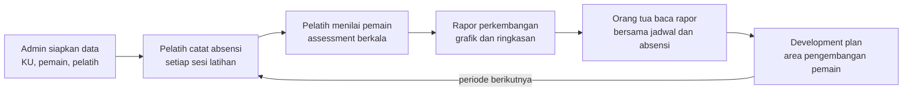

# Rancangan Aplikasi Manajemen & Pengembangan Pemain SSB

> Salinan dokumen rancangan yang diekspor dari Claude Docs pada 2026-10-17. Dua diagram di dokumen aslinya (alur pengguna dan roadmap) dituliskan ulang di sini sebagai Mermaid dan tabel. Setiap perubahan besar pada rancangan dicatat sebagai commit baru supaya riwayatnya bisa ditelusuri.

## Ringkasan dan visi

Aplikasi ini membantu SSB dan akademi sepak bola usia dini mencatat, menilai, dan memantau perkembangan pemain secara terstruktur, lalu membagikan hasilnya ke orang tua dalam laporan yang mudah dipahami.

Referensi kita adalah [Inscout.id](https://inscout.id/), platform manajemen SSB yang punya sistem assessment sendiri (IPAS). Dari analisis paketnya, assessment dibuka gratis sebagai daya tarik, sedangkan yang dijual di paket berbayar adalah administrasi keuangan seperti SPP, gaji pelatih, dan pembukuan. Untuk MVP kita memilih urutan yang berbeda: pengembangan pemain lebih dulu, administrasi menyusul.

Pembeda yang ingin kita bangun:

- Assessment terstruktur per kelompok usia (KU), dengan grafik perkembangan dari waktu ke waktu
- Rapor yang bisa dibaca orang tua, sehingga nilai akademi terlihat jelas di luar lapangan
- Data assessment yang rapi sebagai bahan dasar AI dan Computer Vision di roadmap

## Tujuan dan prinsip produk

MVP diukur dari satu hal: pelatih bisa menilai pemain dari HP di lapangan, dan orang tua bisa membaca hasilnya.

Keputusan yang sudah disepakati:

- MVP berfokus pada pengembangan pemain. SPP dan administrasi lain masuk fase berikutnya.
- AI dan Computer Vision masuk roadmap sebagai rencana ke depan, bukan bagian MVP.
- Roadmap bertahap dari MVP, administrasi, bisnis dan keuangan, lalu AI dan Computer Vision.

Prinsip rancangan (usulan, bisa diubah):

- **Pelatih dulu.** Input assessment dan absensi harus cepat dan nyaman dipakai di HP, karena di situlah data lahir.
- **Satu SSB, satu ruang data.** Data tiap akademi terpisah penuh dari akademi lain.
- **Data anak dilindungi.** Orang tua hanya melihat data anaknya sendiri, dan pelatih hanya melihat KU yang ditugaskan.
- **Indikator bisa diatur.** Template penilaian per KU, bukan angka yang dikunci di kode.

## Pengguna dan role

Ada empat role di dalam SSB, mengikuti pembagian yang dipakai Inscout, ditambah satu role internal untuk kita sebagai pengelola platform.

| Role | Peran | Akses utama di MVP |
| --- | --- | --- |
| Admin SSB | Pengelola akademi | Mengatur KU, pemain, pelatih, template assessment; melihat semua laporan |
| Pelatih | Pengamat dan penilai | Melihat pemain di KU yang ditugaskan; mengisi absensi dan assessment; menulis development plan |
| Korlas | Koordinator kelompok usia | Memantau absensi dan hasil assessment di KU yang dikoordinasi |
| Orang Tua | Pemantau perkembangan anak | Melihat profil, jadwal, absensi, dan rapor anak sendiri; hanya baca |
| Admin Platform | Tim kita (internal) | Mengelola akun SSB dan paket langganan |

Satu orang tua bisa terhubung ke lebih dari satu anak. Wewenang Korlas atas rapor (hanya memantau, atau ikut meninjau sebelum dibagikan) belum diputuskan dan dicatat di bagian pertanyaan terbuka.

## Scope MVP

MVP mencakup semua yang dibutuhkan untuk satu siklus pengembangan pemain: data pemain, absensi, assessment, rapor, dan akses orang tua.

**Masuk MVP**

- Akun SSB, login, role, dan data terpisah per SSB
- Master data: KU, periode, lokasi latihan
- Data pemain dan pelatih, termasuk penugasan pelatih ke KU
- Jadwal latihan dan absensi dari HP
- Assessment pemain, grafik perkembangan, rapor PDF, dan development plan
- Portal orang tua (hanya baca)
- Kartu pemain digital dengan QR Code

**Tidak masuk MVP**

- Tagihan SPP, pembayaran online, gaji pelatih dan kasbon, aplikasi mobile native (fase 2)
- Event dan pertandingan, termasuk statistik pertandingan (fase 2)
- Pembukuan, neraca, laba rugi, multi-cabang (fase 3); landing page akademi dikerjakan lebih awal
- AI dan Computer Vision (fase 4)

## Modul MVP

Delapan modul membentuk MVP; assessment dan rapor adalah inti yang membedakan produk.

| Modul | Fitur | Aturan bisnis |
| --- | --- | --- |
| Akun dan tenant | Daftar SSB, login, undang pelatih dan orang tua, pengaturan role | Data tiap SSB terpisah; satu orang tua bisa punya beberapa anak |
| Master data | KU, periode atau musim, lokasi latihan | KU ditetapkan admin; pemain berada di satu KU aktif per periode |
| Pemain | Biodata, foto, dokumen, data orang tua, sekolah, status, riwayat SSB | Status: aktif, cuti, atau keluar; riwayat perubahan KU tersimpan |
| Pelatih | Profil, penugasan ke KU | Pelatih hanya melihat pemain di KU yang ditugaskan |
| Latihan dan absensi | Jadwal latihan, absensi dari HP, scan QR kartu, rekap kehadiran | Absensi diisi pelatih KU terkait; rekap per pemain dan per periode |
| Assessment dan rapor | Template indikator, penilaian berkala, grafik dan radar chart, rapor PDF, development plan | Skor tersimpan per periode agar perkembangan bisa dibandingkan |
| Portal orang tua | Jadwal, absensi, dan rapor anak | Hanya baca; hanya data anak sendiri |
| Kartu pemain digital | Nomor anggota, KU, posisi, status, QR Code | QR memuat identitas untuk absensi dan verifikasi |

## Alur pengguna utama

Admin menyiapkan data sekali di awal. Setelah itu pelatih menjalankan putaran absensi dan assessment yang menghasilkan rapor untuk orang tua dan rencana pengembangan untuk periode berikutnya.

## Model assessment

Assessment memakai enam aspek yang sama dengan IPAS Inscout, dengan indikator dan skala yang bisa diatur per KU. Bagian ini paling menentukan mutu produk, jadi indikator harus divalidasi pelatih berlisensi sebelum dikunci.

| Aspek | Contoh indikator (usulan awal) |
| --- | --- |
| Technical | Kontrol bola, passing, dribbling, shooting |
| Physical | Kecepatan, kelincahan, daya tahan |
| Tactical | Penempatan posisi, pemahaman peran |
| Mental | Fokus, kerja sama, sportivitas |
| Movement | Koordinasi, keseimbangan |
| Game Intelligence | Pengambilan keputusan, membaca permainan |

Cara kerjanya:

- Admin memilih atau menyesuaikan template indikator untuk tiap KU.
- Pelatih menilai tiap pemain per periode assessment, lalu skor disimpan per periode.
- Sistem menampilkan radar chart per periode dan grafik perkembangan antar periode.
- Rapor PDF merangkum skor, grafik, catatan pelatih, dan development plan.

Keputusan: skala nilai 1 sampai 10 (diputuskan pemilik produk, 17 Okt 2026). Frekuensi kerja sementara: satu penilaian per pemain per periode, boleh diperbarui, dengan jejak perubahan tiap skor. Masih terbuka: apakah kurikulum Filanesia dari PSSI dipakai sebagai acuan indikator, dan wewenang korlas atas rapor.

## Model data

Semua entitas berada di bawah satu SSB (tenant), dan assessment dihubungkan ke periode supaya perkembangan bisa dibandingkan.

| Entitas | Isi utama | Berelasi dengan |
| --- | --- | --- |
| SSB (tenant) | Nama, kota, provinsi, paket langganan | Semua entitas lain |
| Pengguna | Nama, email, nomor WhatsApp, role | SSB; pelatih; orang tua |
| KU | Nama kelompok, rentang usia | Pemain, pelatih, jadwal |
| Periode | Musim atau semester, tanggal mulai dan selesai | Absensi, assessment |
| Pemain | Biodata, foto, dokumen, sekolah, posisi, status, nomor anggota | KU, orang tua, absensi, assessment |
| Orang tua | Kontak, hubungan dengan anak | Satu atau beberapa pemain |
| Pelatih | Profil, penugasan | KU, sesi latihan, assessment |
| Sesi latihan | Tanggal, jam, lokasi, KU | Absensi |
| Absensi | Status hadir, izin, sakit, atau alpa | Pemain, sesi latihan |
| Template assessment | Aspek dan indikator, skala nilai | KU |
| Assessment | Tanggal, pelatih penilai, catatan | Pemain, periode, template |
| Skor | Nilai per indikator | Assessment |
| Development plan | Area pengembangan, target, catatan | Pemain, periode |

## Paket dan model bisnis

Paket mengikuti fase pengembangan: tiap fase membuka satu lapisan fitur, dan harga belum ditetapkan.

| Paket (usulan) | Fase | Isi |
| --- | --- | --- |
| Dasar | 1 | Pemain, pelatih, absensi, assessment, rapor, portal orang tua, kartu pemain |
| Operasional | 2 | Semua isi Dasar, ditambah SPP, pembayaran online, pengingat WhatsApp, event, gaji pelatih |
| Akademi | 3 | Semua isi Operasional, ditambah pembukuan, landing page akademi, multi-cabang, staff dan otoritas, analitik lanjutan |

Sebagai pembanding, [Inscout.id](https://inscout.id/) menjual paket Pro Rp199.000 dan Elite Rp450.000 per bulan, harga tetap per akademi tanpa batas jumlah pemain. Paket Free mereka sudah ditutup karena kuotanya habis (dicek 15 Oktober 2026).

Usulan untuk kita, belum diputuskan:

- Harga bertingkat menurut jumlah pemain, supaya akademi besar membayar sesuai skalanya
- Masa percobaan 14 sampai 30 hari sebagai pengganti paket gratis
- Opsi bayar tahunan dengan diskon

## Roadmap

Roadmap dibagi empat fase: MVP berfokus pada pengembangan pemain, dan AI serta Computer Vision berada di fase terakhir sebagai rencana ke depan. Jalur mobile berkembang bertahap: PWA yang bisa dipasang di fase 2, lalu aplikasi native ke toko aplikasi bila perlu. Rinciannya ada di `docs/mobile.md`.

| Fase | Fokus | Isi | Jalur mobile |
| --- | --- | --- | --- |
| 1 (MVP) | Pengembangan pemain | Akun, role, tenant; pemain dan pelatih; jadwal dan absensi; assessment dan rapor; portal orang tua; kartu pemain QR | Web mobile-first, belum aplikasi native |
| 2 | Administrasi dasar | Tagihan SPP; pembayaran QRIS/VA; pengingat WhatsApp; event dan pertandingan; gaji pelatih dan kasbon; PWA yang bisa dipasang di layar HP; notifikasi push | PWA terpasang, notifikasi push; aplikasi native menyusul |
| 3 | Bisnis dan keuangan | Pembukuan dan laporan; landing page akademi (dikerjakan lebih awal); multi-cabang; staff dan otoritas; analitik lanjutan | Mode offline, dashboard admin di HP, aplikasi native di toko |
| 4 | AI dan Computer Vision | Ringkasan rapor oleh AI; visual pemain (CV); butuh dataset video | Unggah video latihan, ringkasan AI di HP |

Urutan fase tidak berskala waktu. Tanggal dan kriteria lanjut antar fase belum ditetapkan.

## Fitur aplikasi mobile

Aplikasi mobile paling berguna bagi pelatih di lapangan dan orang tua yang ingin kabar cepat, jadi fiturnya dikelompokkan per pengguna dan per fase. Rancangan lengkap, termasuk cara membangunnya, ada di `docs/mobile.md`.

| Fitur | Untuk | Fase (usulan) |
| --- | --- | --- |
| PWA yang bisa dipasang di layar HP (manifest, service worker, ikon) | Pelatih dan orang tua | 2 |
| Absensi sekali ketuk: daftar pemain KU hari ini, tandai hadir, izin, sakit, atau alpa | Pelatih | 2 |
| Scan QR kartu pemain untuk absensi | Pelatih | 2 |
| Input assessment dengan tampilan sentuh, skor per indikator dalam beberapa ketukan | Pelatih | 2 |
| Catatan cepat dan foto per pemain, masuk ke riwayat pemain | Pelatih | 2 |
| Jadwal latihan hari ini dan pengingat | Pelatih | 2 |
| Rapor dan grafik perkembangan anak | Orang tua | 2 |
| Notifikasi push: jadwal berubah, rapor terbit, tagihan jatuh tempo | Orang tua | 2 |
| Ajukan izin tidak hadir untuk anak | Orang tua | 2 |
| Kartu pemain digital dengan QR (sudah ada di web fase 1) | Orang tua | 2 |
| Bayar SPP lewat QRIS atau VA, mengikuti modul SPP | Orang tua | 2 |
| Aplikasi native di Play Store dan App Store (Capacitor) | Pelatih dan orang tua | 3 |
| Mode offline: absensi dan assessment tersimpan saat sinyal lemah, lalu sinkron | Pelatih | 3 |
| Dashboard ringkas: kehadiran, tagihan menunggak, pengumuman | Admin dan Korlas | 3 |
| Pengumuman ke seluruh KU | Admin | 3 |
| Unggah video latihan atau pertandingan untuk analisis | Pelatih | 4 |
| Ringkasan rapor oleh AI di dalam aplikasi | Orang tua | 4 |

Ide lain yang bisa dipertimbangkan setelah fase di atas berjalan: pencatatan skor pertandingan langsung dari HP, galeri highlight pemain, dan chat singkat antara pelatih dan orang tua. Ketiganya belum dijadwalkan.

Pilihan bentuk aplikasinya, PWA dulu atau langsung native, ada di `docs/mobile.md` dan bagian Tech stack.

## Landing page akademi

Aplikasi menjawab pertanyaan orang tua tentang anaknya. Landing page menjawab pertanyaan calon orang tua tentang akademi: apakah akademi ini ada, programnya apa, dan cara mendaftarnya. Dua hal berbeda, dan yang kedua belum ada.

Rancangan lengkap ada di `docs/profil.md`. Keputusannya:

- Landing berdiri sendiri di domain akademi (mis. `familyunitedfa.com`), terpisah dari SSB MS. Tampilannya dari desain tim di repo `ssb-family-united`.
- Isinya diatur di SSB MS (halaman **Konten situs**, draf lalu **Terbitkan**) dan dibaca landing lewat API publik. Landing membaca versi terbit saat halaman dibuka, jadi terbit langsung terlihat tanpa build ulang.
- Pendaftaran trial dari landing masuk ke kotak masuk **Pendaftar** di SSB MS.
- Data pemain tidak pernah tampil publik. Nama pelatih hanya tampil setelah anggota yang bersangkutan menyetujui.
- Program, pelatih, dan fasilitas diturunkan dari data yang sudah ada (KU, anggota, lokasi), dan admin bisa menimpa teksnya.

Landing dikerjakan lebih awal dari fase 3 karena akademi pertama membutuhkannya sekarang. Fitur lain dari bagian ini (multi-cabang, pembukuan) tetap di fase 3.

## Kebutuhan non-fungsional

Aplikasi menyimpan data anak-anak dan dipakai di lapangan, jadi keamanan data dan kenyamanan di HP menjadi syarat utama. Usulan tech stack ada di bagian sesudahnya.

Kebutuhan yang perlu dipenuhi:

- **Mobile-first.** Semua alur pelatih nyaman dipakai di layar HP.
- **Isolasi data antar SSB.** Tidak boleh ada data satu akademi terlihat oleh akademi lain.
- **Perlindungan data anak.** Akses per role, persetujuan orang tua untuk foto dan dokumen, dan kepatuhan pada UU Pelindungan Data Pribadi (perlu dicek lebih rinci).
- **Jejak perubahan.** Perubahan skor assessment tercatat, supaya rapor bisa dipertanggungjawabkan.
- **Cadangan data** berkala.

Keputusan teknis yang masih terbuka:

- Bentuk aplikasi mobile di fase 2: Capacitor atau Flutter
- Perlu tidaknya input offline saat sinyal di lapangan lemah
- Tempat penyimpanan foto dan dokumen pemain
- Cara membuat rapor PDF
- Persetujuan atas usulan infrastruktur

## Tech stack

Usulan stack memakai satu bahasa, TypeScript, dari web sampai API, dengan PostgreSQL sebagai database dan Python hanya untuk AI di fase 4. Backend (Hono, dengan Bun untuk tooling dan runtime) dan frontend (SolidStart) sudah diputuskan setelah benchmark; sisanya masih usulan.

| Lapisan | Usulan | Alasan |
| --- | --- | --- |
| Web (fase 1) | **SolidStart** sebagai PWA | Diputuskan. JS klien sekitar 8x lebih kecil dan SSR jauh lebih cepat daripada Next.js (lihat benchmark); mobile-first, bisa dipasang di layar HP, kamera browser cukup untuk scan QR |
| Backend | **Hono** (TypeScript), berjalan di Bun | Diputuskan. Ringan, API berbasis standar web, satu bahasa dengan frontend; modular monolith cukup untuk MVP |
| Database | PostgreSQL, multi-tenant dengan kolom ssb_id dan Row Level Security | Data antar SSB terisolasi di level database, bukan hanya di kode |
| ORM dan validasi | Drizzle atau Prisma, validasi dengan Zod | Skema dan tipe data dipakai bersama frontend lewat monorepo (Bun workspaces) |
| Penyimpanan file | S3-compatible (R2 atau MinIO di VPS) | Foto dan dokumen pemain tidak membebani database |
| Rapor PDF | Render HTML ke PDF di server dengan Playwright, dijalankan di Node (bukan Bun) | Tampilan rapor dirancang dengan HTML dan CSS biasa, grafik ikut tercetak |
| Job terjadwal (fase 2) | BullMQ dengan Redis | Pembuatan tagihan SPP bulanan dan pengingat WhatsApp |
| Pembayaran (fase 2) | Midtrans atau Xendit | QRIS dan VA siap pakai |
| Deploy | Docker Compose di VPS, Caddy atau Nginx, cadangan pg_dump ke object storage | Murah dan cukup untuk tahap awal |
| AI dan CV (fase 4) | Service Python terpisah (FastAPI) | Ekosistem AI paling matang; dipisah agar tidak mengganggu API utama |

### Keputusan backend: Hono di atas Bun

Bun dipakai sebagai package manager, test runner, dan runtime API. Hindari modul native (bcrypt, argon2; sharp belum diverifikasi), dan jalankan worker PDF Playwright di Node.

Benchmark (sandbox 2 vCPU, server dipin ke satu core, autocannon 64 koneksi, median 3 putaran; skrip di `tools/bench/backend`):

- Hono di Bun dan Hono di Node jauh lebih ringan daripada NestJS, baik dari sisi start server, memori, maupun req/s.
- NestJS + Express di Node ternyata lambat karena Express 5 sendiri lambat di Node, bukan karena NestJS; di Bun tidak terlihat.
- Angka detail ada di `tools/bench/backend/results.json`. Angka sintetis tanpa database, jadi dibaca sebagai arah, bukan target produksi.

### Benchmark frontend: Next.js vs SolidStart

Halaman uji: absensi 200 pemain, dirender di server, dengan pencarian dan checkbox di klien. Next.js 16.4.2, SolidStart 2 (beta). Skrip di `tools/bench/frontend`.

| | Next.js 16 | SolidStart 2 |
| --- | ---: | ---: |
| JS klien halaman pertama (mentah / gzip / brotli) | 571 / 176 / 151 KB | 67 / 23 / 21 KB |
| HTML mentah | 48 KB | 33 KB |
| Start server | sekitar 0,9 dtk | sekitar 0,2 dtk |
| RSS idle / setelah beban | 131 / 320 MB | 65 / 190 MB |
| 1 request | 25 ms | 6 ms |
| req/s, 1 core, 64 koneksi | 62-70 (default), 141 (mode klasik) | 596-644 |
| p99 | 6,7 dtk (default), 3,2 dtk (klasik) | 0,26-0,33 dtk |

Batasan: tidak ada browser sehingga hydration dan LCP tidak terukur; halaman sintetis tanpa database; SolidStart 2 masih beta. Pertimbangan di luar angka: ekosistem dan ketersediaan developer Next.js jauh lebih besar. **Keputusan: SolidStart.** Risikonya, v2 masih beta dan komunitasnya lebih kecil; versi dikunci di lockfile dan upgrade dilakukan terencana.

### Aplikasi mobile: PWA dulu, native menyusul

Keputusan ini sengaja belum dikunci untuk bentuk native, karena baru dibutuhkan di fase 2, dan tergantung seberapa penting mode offline di fase 3. Rinciannya ada di `docs/mobile.md`.

| Opsi | Kelebihan | Kekurangan |
| --- | --- | --- |
| PWA (manifest dan service worker di atas SolidStart yang sekarang) | Tidak perlu toko aplikasi, bisa dipakai hari ini, satu basis kode | Push di iOS baru bekerja setelah dipasang ke layar utama; tidak ada offline penuh |
| Capacitor (membungkus PWA SolidJS) | Kode web dipakai ulang, paling cepat sampai ke toko aplikasi | Mode offline dan rasa native kurang kuat; menambah lapisan build Android dan iOS |
| Flutter | Pengalaman native lebih baik, sinkronisasi offline lebih kokoh | Dua basis kode: web dan mobile |

Usulan urutan: PWA di fase 2 awal untuk menutup pemasangan ke layar HP dan notifikasi push, lalu Capacitor untuk versi toko aplikasi di fase 3, dan Flutter hanya kalau mode offline terbukti dibutuhkan. Bila fase 3 (offline penuh) benar-benar dikejar, Flutter lebih aman. Bila kecepatan menuju toko aplikasi lebih penting, Capacitor.

### Prinsip arsitektur

- **API-first.** Semua logika bisnis ada di backend, bukan di frontend, supaya web dan mobile memakai API yang sama dan opsi mobile tetap terbuka.
- **Modular monolith, bukan microservice.** Satu aplikasi backend dengan modul yang terpisah rapi sesuai modul MVP; dipecah hanya bila ada alasan nyata.
- **Isolasi tenant sejak awal.** Row Level Security dipasang dari migrasi pertama, karena menambahkannya belakangan jauh lebih sulit.
- **AI dan CV sebagai service terpisah.** Berkomunikasi lewat API dan antrean job, sehingga bisa dikembangkan tanpa menyentuh inti aplikasi.

## Risiko dan pertanyaan terbuka

Risiko terbesar MVP ada di sisi pengguna, bukan teknis: indikator yang tidak dipercaya pelatih, atau pengisian data yang terasa merepotkan.

| Risiko | Penanganan yang diusulkan |
| --- | --- |
| Indikator assessment dianggap tidak valid atau terlalu rumit | Libatkan pelatih berlisensi sejak awal; uji di satu SSB percontohan |
| Pelatih enggan mengisi data di lapangan | Buat alur pendek yang nyaman di HP; uji langsung saat latihan |
| Orang tua jarang membuka rapor | Rapor ringkas dan mudah dibaca; pengingat WhatsApp di fase 2 |
| Kebocoran atau penyalahgunaan data anak | Akses per role, jejak perubahan, dan peninjauan aspek hukum |
| Profil publik membocorkan data pemain atau anak | Hanya data yang ditandai terbit yang tampil; nama pemain dikecualikan seluruhnya |
| Notifikasi push tidak sampai ke orang tua | PWA punya batas di iOS; aplikasi native ke toko aplikasi menutupnya |

Pertanyaan yang perlu dijawab sebelum membangun:

- [ ] Skala nilai dan frekuensi assessment
- [ ] Wewenang Korlas atas rapor
- [ ] Acuan indikator, termasuk apakah kurikulum Filanesia dipakai
- [ ] SSB percontohan untuk menguji MVP
- [ ] Kriteria untuk lanjut dari satu fase ke fase berikutnya
- [ ] Harga dan struktur paket
- [ ] Bentuk aplikasi mobile: PWA dulu atau langsung native, dan kalau native, Capacitor atau Flutter
- [x] Bentuk landing page: terpisah dari SSB MS, konten diatur di SSB MS (diputuskan 23 Okt 2026)
- [ ] Apakah nama pelatih ditampilkan di profil publik, dan bagaimana persetujuannya
- [ ] Apakah tarif SPP ditampilkan di profil publik
- [ ] Apakah orang tua boleh absen sendiri lewat QR
- [ ] Kapan mode offline dianggap wajib, bukan bonus
